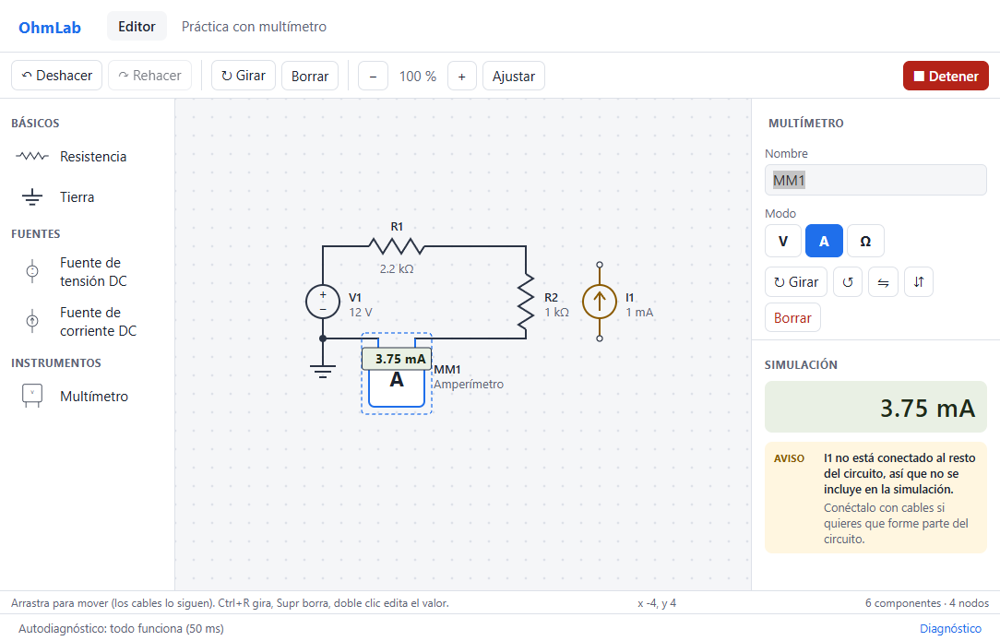
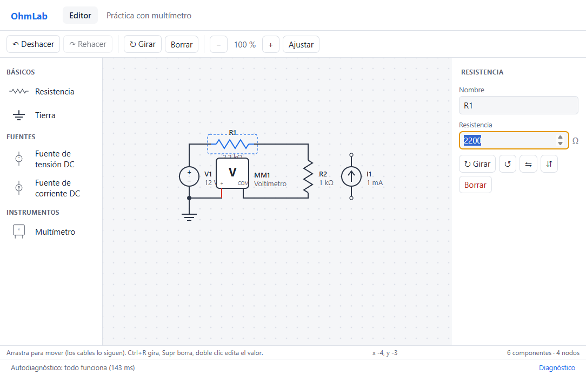
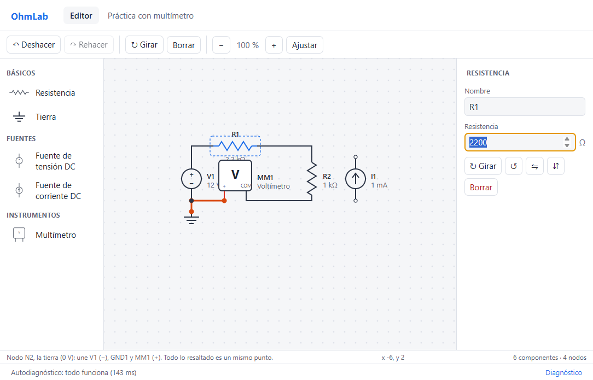
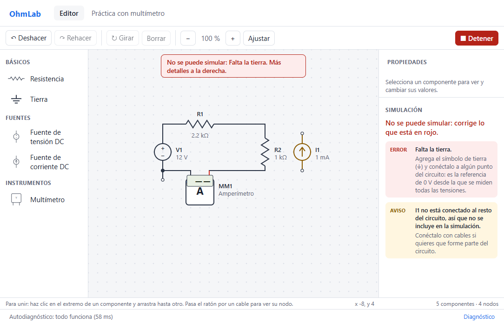
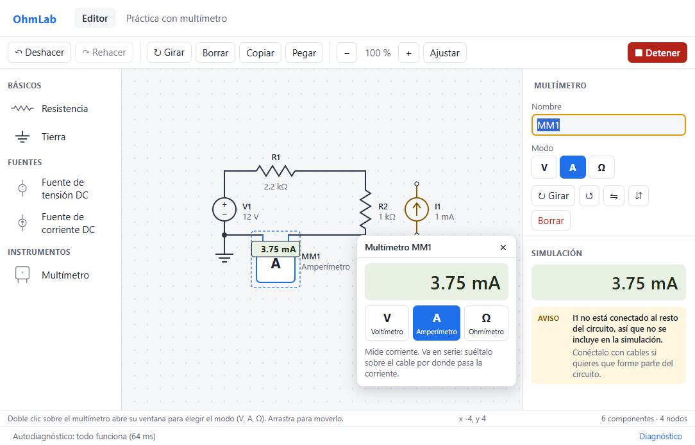
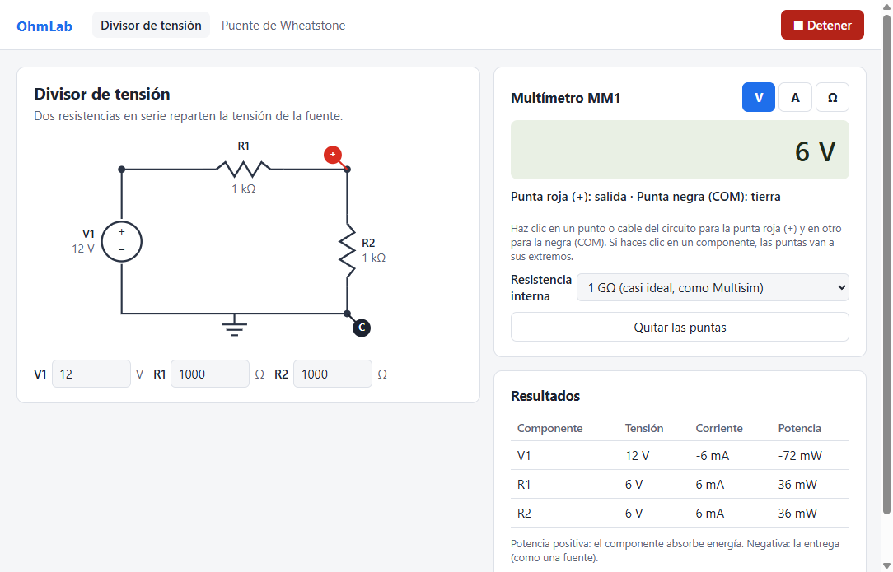
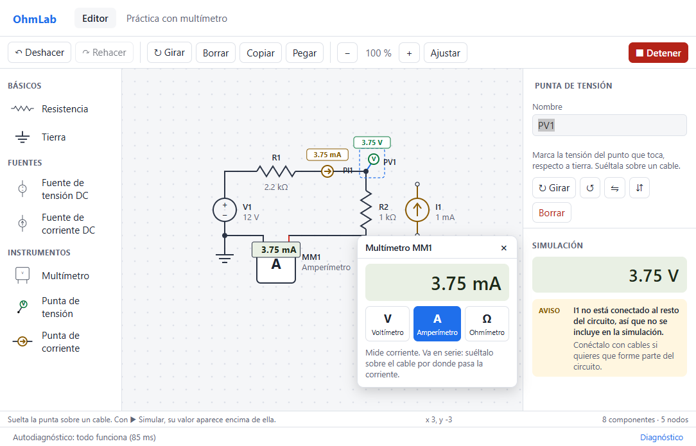

# OhmLab

Simulador de circuitos libre y gratuito para estudiantes. Funciona sin internet
y usa [ngspice](https://ngspice.sourceforge.io/) como motor de simulación.

> En desarrollo. Desarrollado por estudiantes de la UNT.

## Estado

- [x] Paso 1: ejecutar ngspice y comparar resultados con la teoría
- [x] Paso 2: núcleo en TypeScript + pruebas automáticas
- [x] Paso 3: revisión del circuito con mensajes en español + autodiagnóstico
- [x] Paso 4: ventana de la aplicación (Electron) con autodiagnóstico
- [x] Multímetro (voltímetro, amperímetro y ohmímetro) sobre circuitos de práctica
- [x] Paso 5: lienzo del editor (colocar, mover, girar, voltear, borrar, deshacer)
- [x] Paso 6: cables y detección de nodos
- [x] Paso 7: simular desde el editor (en vivo, con los resultados sobre el dibujo)
- [x] Paso 8: copiar y pegar, y valores con prefijos (4.7k, 10m, 1M)
- [x] Paso 9: guardar y abrir archivos (.ohmlab)
- [x] Paso 10: instalador de Windows (ngspice incluido)
- [ ] Linux, publicación en GitHub Releases y firma del instalador (necesitan el proyecto en GitHub)



## Estructura

```
apps/desktop/           Aplicación de escritorio (Electron + React)
  src/main/             Proceso principal: ventana, menú, simulación
  src/preload/          Puente seguro entre la ventana y el proceso principal
  src/renderer/         Interfaz (React)
packages/core/          Núcleo en TypeScript
  src/components/       Un archivo por tipo de componente
  src/erc.ts            Revisión del circuito antes de simular
  src/simulate.ts       Simulación DC
  src/node/             Partes que necesitan Node: motor ngspice y autodiagnóstico
test-circuits/          Circuitos de prueba con su resultado teórico (.json)
docs/                   Notas de diseño y de seguridad
scripts/paso1/          Prueba inicial de ngspice (histórico)
```

## Instalador de Windows

Un solo archivo, `OhmLab-<versión>-instalador-windows.exe` (≈ 110 MB), que trae
todo lo necesario y funciona sin internet:

- Se instala **por usuario**, sin pedir permisos de administrador (sirve en las
  PC del laboratorio). Se puede elegir la carpeta.
- Accesos directos en el escritorio y en el menú Inicio, y los archivos
  `.ohmlab` se abren con doble clic.
- Incluye ngspice (solo el programa de consola y sus 3 bibliotecas, ≈ 12 MB) y
  las licencias de todo lo que trae, en la carpeta `resources/licencias`
  (ver `TERCEROS.txt`). No incluye modelos de fabricantes.
- El desinstalador no deja restos (ni registro ni carpeta de datos).
- Mientras no esté firmado, Windows muestra «Windows protegió su PC»: se pasa
  con «Más información → Ejecutar de todas formas».

Para armarlo (PowerShell, desde la carpeta del proyecto):

```powershell
$env:ELECTRON_BUILDER_CACHE = "F:Herramientaselectron-builder-cache"
npm.cmd run dist:win -w @ohmlab/desktop
```

Queda en `apps/desktop/dist`. ngspice se toma de `F:Herramientas
gspiceSpice64`
(o de la carpeta que indique la variable `NGSPICE_HOME`).

## Archivos

Los circuitos se guardan en archivos **.ohmlab** (menú Archivo, o Ctrl+S): texto
legible (JSON) con las piezas, sus valores y los cables. No llevan código, así
que abrir uno no puede ejecutar nada.

- El título de la ventana muestra el nombre del archivo y un punto (•) si hay
  cambios sin guardar. Antes de cerrar, abrir otro o empezar uno nuevo, OhmLab
  pregunta si se guardan.
- Al abrir, el archivo se revisa entero (tipos de pieza conocidos, valores que
  son números, cables rectos...). Si algo no cuadra, se explica qué y no se
  abre a medias.

## Editor



- Paleta por categorías: arrastra un componente al lienzo, o haz clic en él y
  luego en el lienzo.
- **Cables:** clic en el extremo de un componente y arrastra hasta otro. O haz
  clic y suelta: el cable sigue al ratón, cada clic hace una esquina, y termina
  al hacer clic en un pin o en un cable (o con doble clic). Esc lo cancela.
- **Nodos:** al pasar el ratón por un cable se resalta todo su nodo y la barra
  de estado dice qué une. Las uniones de tres o más conexiones llevan un punto,
  y los pines sin conectar se ven como un círculo vacío.
- **Intercalar:** si sueltas un componente con sus dos pines sobre un cable,
  queda en serie (una línea roja punteada avisa antes qué tramo se quita). Así
  se pone el amperímetro sin abrir el circuito a mano.
- Al mover o girar un componente, sus cables lo siguen.
- Grilla, zoom con la rueda del ratón, mover la vista con espacio + arrastrar
  (o el botón central), y selección con un recuadro.
- Doble clic en un componente para cambiar su valor. Se puede escribir con
  prefijos, como en clase: `4.7k`, `4k7`, `10m`, `2u`, `1M`. La **M**
  mayúscula es mega y la **m** minúscula es mili (al revés que en SPICE: OhmLab
  le pasa a ngspice el número ya convertido).
- Copiar y pegar: al copiar piezas también se copian los cables que las unen.
  Se pega donde está el ratón.
- Atajos de teclado habituales en los simuladores de circuitos:

| Atajo | Acción |
|---|---|
| Ctrl+R / Ctrl+Shift+R | Girar 90° a la derecha / a la izquierda |
| Alt+X / Alt+Y | Voltear horizontal / vertical |
| Supr | Borrar |
| Ctrl+C / Ctrl+V / Ctrl+X | Copiar / pegar / cortar |
| Ctrl+N / Ctrl+O | Circuito nuevo / abrir |
| Ctrl+S / Ctrl+Shift+S | Guardar / guardar como |
| Ctrl+Z / Ctrl+Y | Deshacer / rehacer |
| Ctrl+A | Seleccionar todo |
| Esc | Cancelar |
| F5 | Simular / detener |

Recargar la ventana pasó a **Ctrl+F5**, porque Ctrl+R gira componentes y F5 simula.



## Simular

Pulsa **▶ Simular** (o F5). Mientras la simulación está encendida puedes seguir
editando: cada cambio se vuelve a simular solo.

- Para medir, se usa el multímetro, como en el laboratorio: OhmLab no escribe
  los voltajes en los nodos.
- El multímetro muestra su lectura en su propia pantalla, sobre el dibujo.
  Si marca negativo, el panel explica por qué (la corriente entra por COM, o la
  punta + está en el punto de menor tensión) y cómo verlo positivo: Alt+X.
- Las piezas no muestran valores por sí solas: todo se mide con el multímetro,
  como en el laboratorio. Lo que marca cada multímetro también se ve en el
  panel de la derecha.
- Si hay un error (por ejemplo, falta la tierra), no se muestra ningún número:
  aparece un aviso sobre el lienzo y la explicación a la derecha, y las piezas
  con problemas se marcan en rojo.



## Multímetro

Un multímetro con tres modos, que se conecta como uno real: en paralelo para
medir tensión y en serie para medir corriente.

- **Voltímetro:** resistencia interna configurable: 1 GΩ (casi ideal), 10 MΩ
  (como uno de laboratorio, para ver el efecto de carga) o 1 MΩ.
- **Amperímetro:** ideal (no cambia el circuito).
- **Ohmímetro:** mide con las fuentes apagadas, así que da la resistencia
  de Thévenin entre las puntas. Si no hay camino entre ellas, marca **OL**.
- Avisa de los errores típicos: amperímetro en paralelo (cortocircuita lo
  que mide), amperímetro directo a una fuente, voltímetro en serie.

En el editor se arrastra desde la paleta («Multímetro») y se conecta con cables,
o se suelta sobre un cable para intercalarlo. Con **doble clic** se abre su
ventana: pantalla, modo (V, A, Ω) y, en voltímetro, la resistencia interna. La
ventana se puede arrastrar; el modo también se puede cambiar en el panel de la
derecha.

 La pestaña «Práctica con multímetro» sigue como
ejercicio guiado sobre un divisor y un puente de Wheatstone.



## Puntas de prueba

Para revisar varios puntos rápido, sin armar el multímetro (en la paleta, en
Instrumentos):

- **Punta de tensión:** se suelta sobre un cable y marca la tensión de ese
  punto respecto a tierra. No cambia el circuito.
- **Punta de corriente:** se suelta sobre un cable, queda en serie y marca la
  corriente que pasa por él. Es positiva en el sentido de su flecha; Alt+X la
  voltea.

Sirven, por ejemplo, para comprobar Kirchhoff: una punta de corriente en cada
rama que llega a un nodo.



## Revisión del circuito

Antes de simular, OhmLab busca los errores típicos y los explica en español.
Esto es necesario porque ngspice, en varios de estos casos, devuelve números
sin sentido **sin avisar**.

| Error (no deja simular) | Aviso (simula igual) |
|---|---|
| Falta la tierra o no está conectada | Terminal suelto |
| Fuentes de tensión en paralelo o en lazo | Componente sin conectar (se ignora) |
| Fuente de tensión en cortocircuito | Componente en cortocircuito |
| Fuente de corriente con un terminal al aire | Circuito sin fuentes |
| Fuentes de corriente en serie | |
| Parte sin camino a tierra o separada | |
| Valores inválidos (p. ej. resistencia de 0 Ω) | Amperímetro en paralelo o voltímetro en serie |
| Amperímetro conectado directo a una fuente | |

## Abrir la aplicación

Requiere Node.js 24 y ngspice (ver abajo).

```bash
npm install
npm run app
```

En Windows PowerShell usa `npm.cmd` en lugar de `npm` si aparece "la ejecución
de scripts está deshabilitada".

**Prueba de humo:** con la variable `OHMLAB_SMOKE_TEST=captura.png`, la app se
abre, simula, prueba un error a propósito, abre el diagnóstico, guarda
capturas y se cierra sola (código 0 si todo salió bien).

## Pruebas

Requiere Node.js 24 y ngspice.

```bash
npm install
npm test
```

En Windows PowerShell, si aparece "la ejecución de scripts está deshabilitada",
usa `npm.cmd test`.

ngspice se busca en la variable `NGSPICE_PATH`; si no existe, en
`F:/Herramientas/ngspice/...` y después en el `PATH` (Linux: `sudo apt install ngspice`).

Para añadir un circuito de prueba, crea un `.json` en `test-circuits/`. Además de
los valores esperados, en cada circuito se comprueba automáticamente la ley de
corrientes de Kirchhoff, el balance de potencia y que no haya avisos inesperados.

## Licencia

Código propio: [MIT](LICENSE). Las licencias de terceros (ngspice, modelos) se
documentarán en `third_party/` y `models/`.
